# Flowchart แต่ละ Rule

แผนภาพจากโค้ดใน `src/BotReport2026/` (v0.2.0) ณ วันที่ 23 ต.ค. 2026 — ใช้คู่กับ
[rule-data-sources-th.md](rule-data-sources-th.md) ซึ่งอธิบายไฟล์และคอลัมน์โดยละเอียด

ค่าตัวเลขในแผนภาพเป็นค่าที่ตั้งไว้ตอนนี้ (แก้ได้ในแท็บตั้งค่า)

---

## ภาพรวมการรันรายงาน

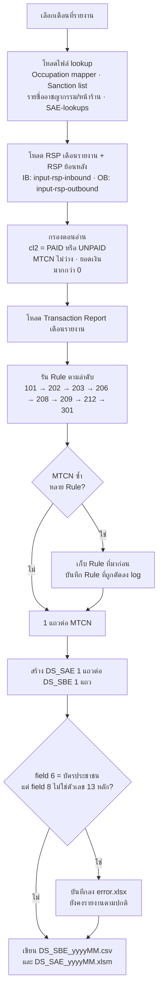

## การแยกขาเข้า / ขาออก (ใช้ใน 202, 203-Retail, 206, 208, 209)

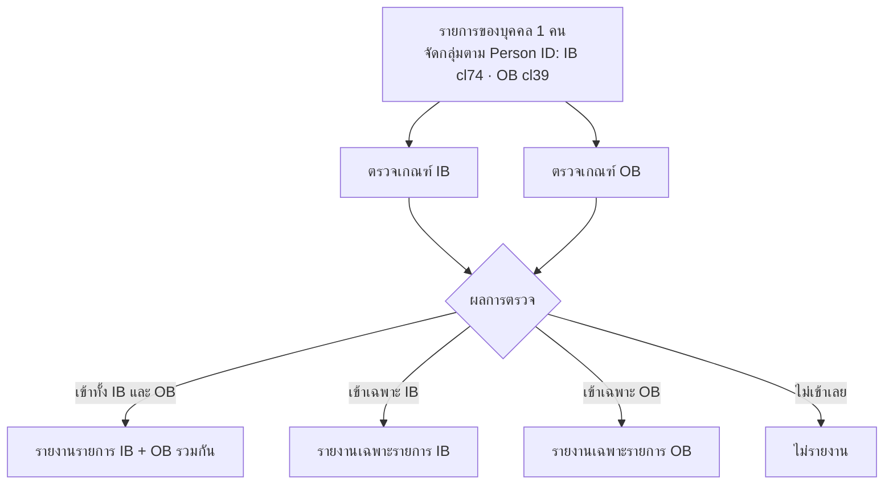

---

## Rule 101 — ตรงกับ Sanction List

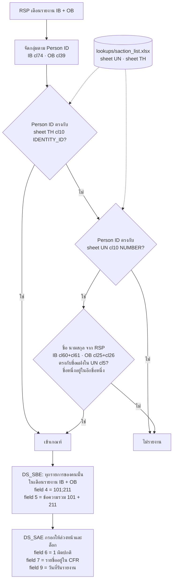

## Rule 202 — มูลค่าธุรกรรมเฉลี่ยต่อเดือนสูงกว่าที่ผ่านมา

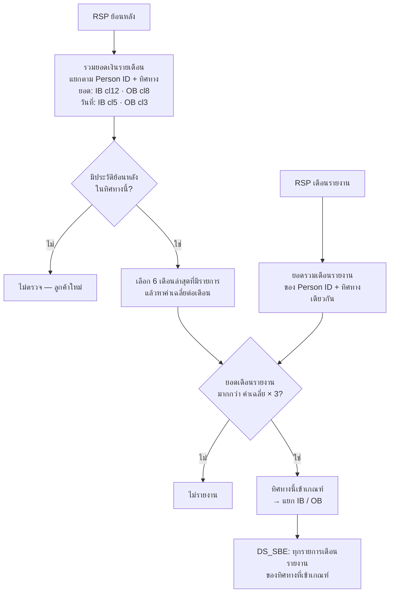

## Rule 203-Online — ไม่สอดคล้องกับรายได้ (ช่องทางออนไลน์)

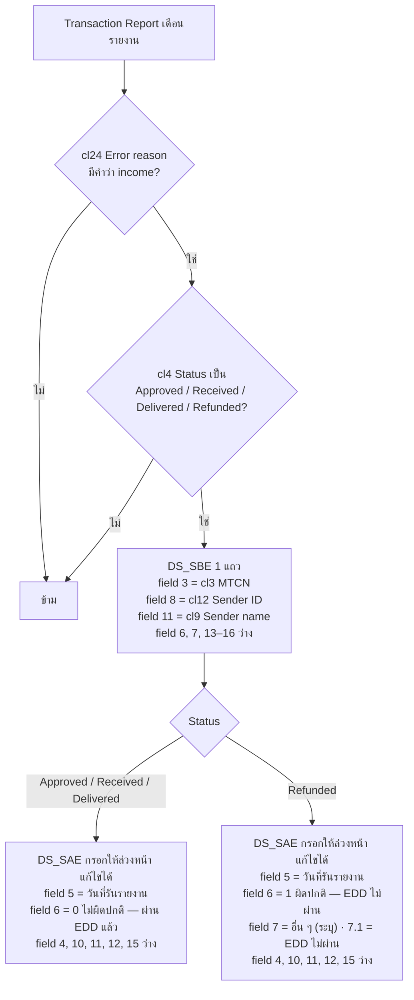

## Rule 203-Retail — ไม่สอดคล้องกับรายได้ (หน้าร้าน)

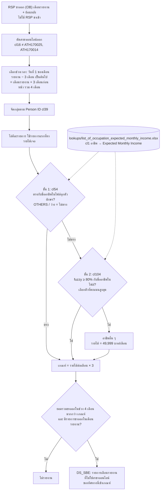

## DS_SBE field 16 — รหัสอาชีพ (ทุก Rule ยกเว้น 203-Online)

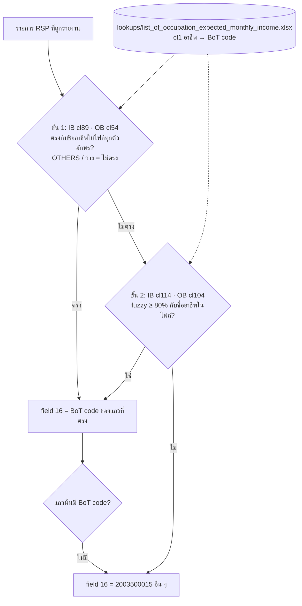

## Rule 206 — ธุรกรรมในสาขาพื้นที่เสี่ยง

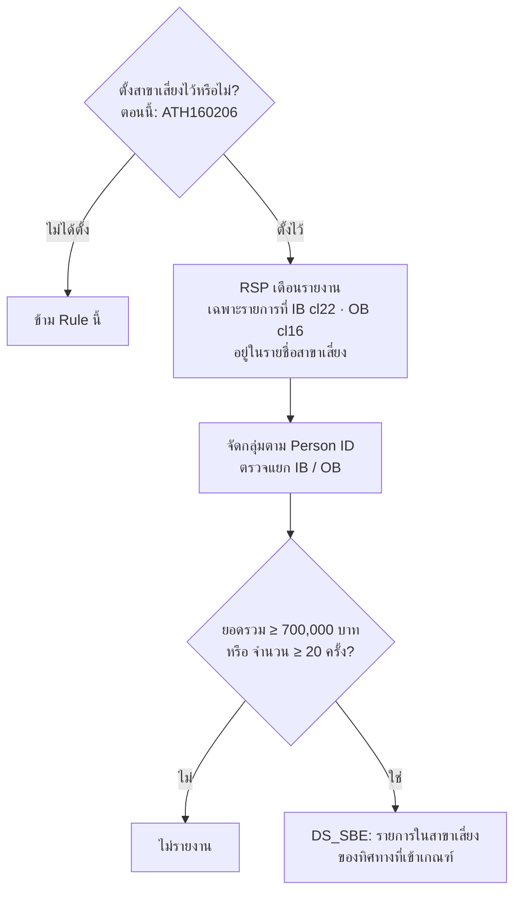

## Rule 208 — Structuring (ทำถี่ ยอดต่ำกว่าเกณฑ์)

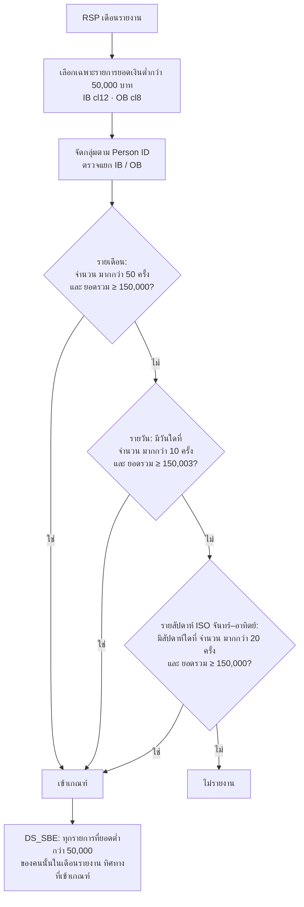

## Rule 209 — ทำธุรกรรมต่อเนื่อง 24/7

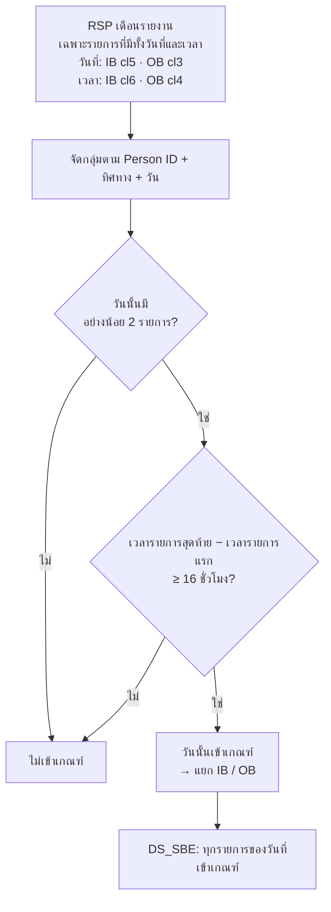

## Rule 212 — บุคคลอาชญากรรมทางการเงิน

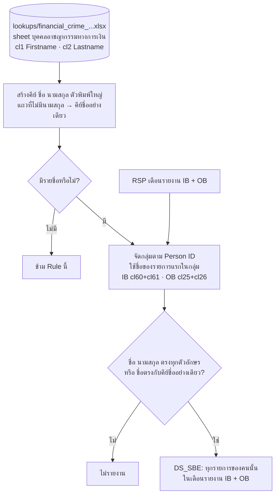

## Rule 301 — พฤติกรรมลูกค้าหน้าร้านน่าสงสัย

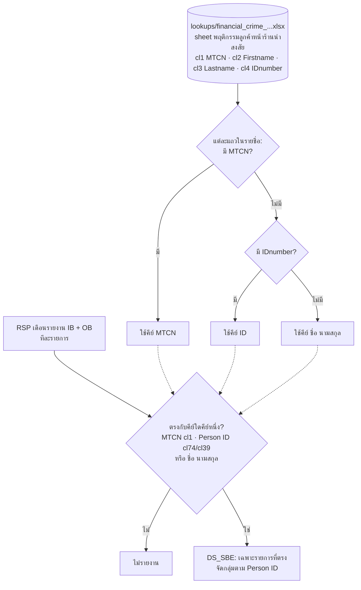
